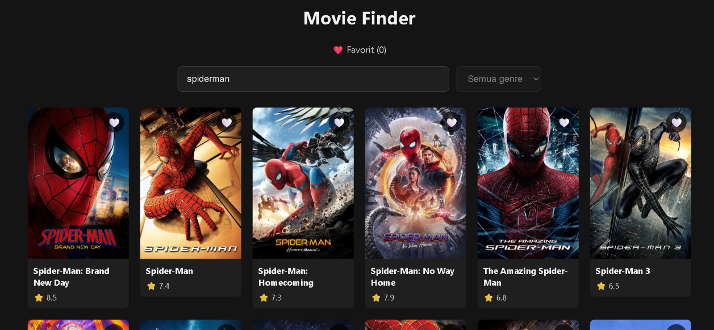
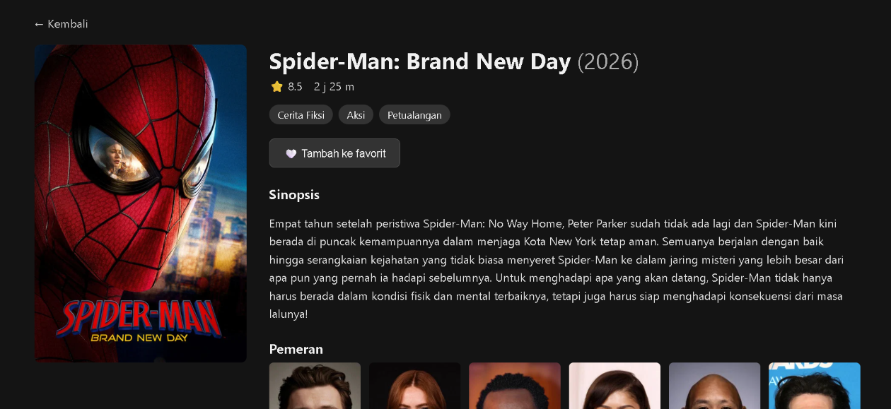

# Movie Finder

Aplikasi web untuk mencari dan menjelajahi film, dibuat dengan React sebagai
proyek portofolio pribadi.

**Demo:** https://movie-finder-sigma-eight.vercel.app/

## Fitur

- Daftar film populer dengan tombol "Muat lebih banyak"
- Pencarian film dengan debounce, jadi API tidak dipanggil di setiap ketikan
- Filter berdasarkan genre
- Halaman detail: sinopsis, durasi, genre, pemeran, dan trailer
- Daftar film favorit yang tersimpan di localStorage
- Kata kunci pencarian dan genre tersimpan di URL, jadi hasilnya bisa dibagikan lewat tautan
- Tampilan responsif (HP, tablet, desktop), skeleton loading, serta penanganan loading dan error
- Skor Lighthouse Accessibility 100

## Teknologi

React, Vite, React Router, Context API, JavaScript, CSS, TMDB API

## Menjalankan di komputer sendiri

1. Clone repo ini dan masuk ke foldernya:
   `git clone https://github.com/rafinelsa664/movie-finder.git`
2. Jalankan `npm install`
3. Buat file `.env` di folder utama berisi:
   `VITE_TMDB_API_KEY=api_key_tmdb_kamu`
4. Jalankan `npm run dev`

API key gratis bisa diminta di [themoviedb.org](https://www.themoviedb.org/).

## Screenshot

## Hal yang dipelajari

- Mengelola state dan efek samping dengan hooks React
- Membuat banyak halaman dengan React Router dan parameter URL
- Berbagi state antar komponen dengan Context API
- Menyimpan data di localStorage dan di URL
- Dasar-dasar aksesibilitas dan tampilan responsif
- Deploy aplikasi ke Vercel

## Catatan

This product uses the TMDB API but is not endorsed or certified by TMDB.